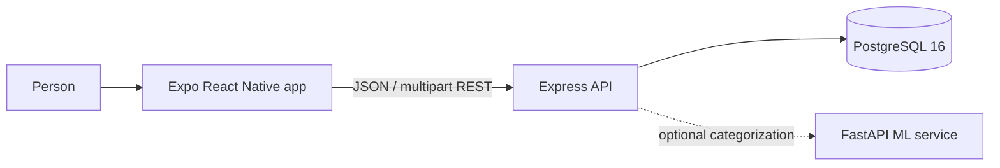

# Ledgerly — Personal Finance Dashboard

**Your money, clearly categorized.**

Ledgerly turns a bank statement into a clear view of income, spending, and category trends. Import a CSV, correct categories as needed, and review monthly summaries and a simple three-month forecast.

## Architecture



The mobile app runs on the host through Expo. Docker Compose runs PostgreSQL, the Express API, and the ML service.

## Stack

- **Mobile:** React Native, Expo SDK 51, TypeScript, Expo Router, React Query, SecureStore, Document Picker, `StyleSheet`, and `react-native-chart-kit`.
- **API:** Node 20, Express 4, TypeScript, PostgreSQL 16 (`pg`), bcrypt-compatible password hashing (cost 12), JWT, Zod, and rate limiting.
- **ML service:** Python 3.11 and FastAPI, kept as a separate internal service.
- **Local infrastructure:** Docker Compose.

## Local setup

1. Copy `.env.example` to `.env`. Replace the two JWT secrets before exposing the stack beyond local development.

2. Start the backend services:

   ```sh
   docker compose up --build
   ```

   PostgreSQL has a health check. The API waits for it, applies migrations, seeds the default categories, and creates the demo account and synthetic transaction history when absent. The API health endpoint is `http://localhost:4000/health`.

3. Set up the mobile app. Copy `mobile/.env.example` to `mobile/.env` and set `EXPO_PUBLIC_API_URL` to the host computer's LAN IP, for example `http://192.168.1.20:4000`. Do not use `localhost` from a phone or emulator: that points back to the device. Keep the phone and development computer on the same reachable network.

   ```sh
   cd mobile
   npm install
   npx expo start
   ```

   Scan the QR with an Expo Go build compatible with SDK 51. An Android emulator can use the QR or `npx expo start --android`. iOS Simulator requires macOS and Xcode. Physical iPhones cannot install older Expo Go builds for SDK 53 or earlier; use a development build or the recorded demo instead. See [Expo's SDK mismatch guide](https://docs.expo.dev/troubleshooting/expo-go-version-mismatch/).

### Mobile demo

The seeded demo account is available from **Try Ledgerly demo** on the login screen:

- Email: `demo@ledgerly.local`
- Password: `LedgerlyDemo123!`

For recruiter sharing, use a short screen recording as the reliable link. An Expo Go QR works on devices with the SDK 51 compatible client; an EAS development build can be shared when a signed build is available. Native requests usually omit `Origin`; browser development origins are limited to the configured web origin and the Expo development origins.

### Auth transport

Access JWTs expire after 15 minutes and stay in app memory. The seven-day refresh JWT is stored in `expo-secure-store`, sent as a Bearer token to `/api/auth/refresh`, rotated on use, and returned in the response body for the mobile client. The API also accepts the existing `httpOnly`, `SameSite=Lax` refresh cookie for web clients. Logout revokes the current refresh token.

## API overview

Authenticated routes use `Authorization: Bearer <access-token>` unless noted.

| Area | Routes |
| --- | --- |
| Auth | `POST /api/auth/register`, `POST /api/auth/login`, `POST /api/auth/refresh`, `GET /api/auth/me`, `POST /api/auth/logout` |
| CSV uploads | `POST /api/uploads`, `GET /api/uploads`, `GET /api/uploads/:id/status` |
| Transactions | `GET /api/transactions`, `POST /api/transactions`, `PATCH /api/transactions/:id`, `DELETE /api/transactions/:id`, `POST /api/transactions/bulk-categorize` |
| Categories | `GET /api/categories`, `POST /api/categories`, `PATCH /api/categories/:id`, `DELETE /api/categories/:id` |
| Analytics | `GET /api/analytics/summary`, `GET /api/analytics/by-category`, `GET /api/analytics/trend`, `GET /api/analytics/forecast` |

Transaction and upload lists return `{ data, page, limit, total }`. CSVs require `date`, `description`, and `amount`; accepted dates are `YYYY-MM-DD` and `MM/DD/YYYY`, and a malformed row is skipped and reported without failing the other rows.

## Categorization service status

The ML service in this checkout currently exposes only `GET /health`; it does not implement `/ml/predict` or `/ml/retrain`. The API preserves the upload contract when prediction is unavailable: valid rows are still saved, category predictions remain null, and the response carries a warning. Synchronous bulk categorization reports a service-unavailable response instead of inventing predictions. The app's charts, CSV import, filters, and manual category feedback still use the API and seeded data.

## Screenshots

Add current mobile captures here after device review:

- Login: `docs/screenshots/login.png`
- Dashboard: `docs/screenshots/dashboard.png`
- Transactions: `docs/screenshots/transactions.png`
- CSV import: `docs/screenshots/upload.png`

## Verification

```sh
npm run typecheck
npm run lint
npm test --workspace @ledgerly/backend
cd mobile && npm run typecheck && npx expo-doctor
```

Android and iOS Metro bundles can be checked with `npx expo export --platform android` and `npx expo export --platform ios`. `scripts/smoke.sh` exercises the REST API against a running stack and requires `curl` and `jq`.

## What I'd improve

- Complete the TF-IDF/logistic-regression model and retraining endpoint in the ML service, then validate prediction quality against a labeled merchant dataset.
- Add real PostgreSQL container integration coverage and CI that boots the Compose stack and runs the API smoke script.
- Produce and distribute an EAS development build for device review, especially iOS, and replace the screenshot placeholders with reviewed captures.
- Add password reset/change flows and budget editing.
